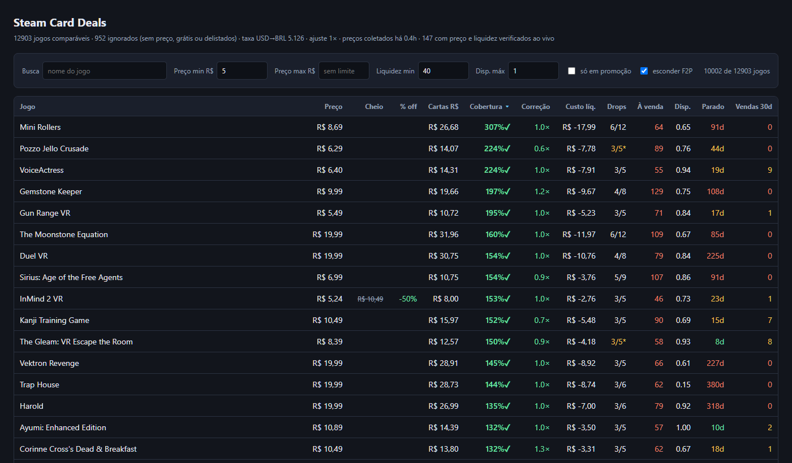

# Steam Card Deals

Finds Steam games that **pay for themselves through their trading cards**. It crosses the market value of each game's card drops with the store price, then checks the live Steam Community Market to drop the ones whose cards don't actually sell.

> Leia em português: [README.pt-BR.md](README.pt-BR.md)



## Tested with real money

I used it to buy games and sold the cards they dropped. Drops were farmed automatically with [ArchiSteamFarm](https://github.com/JustArchiNET/ArchiSteamFarm), so playtime cost nothing.

- **Predicted vs. received:** over 2 batches and 57 cards, the model predicted R$ 43.00 and R$ 40.74 landed in the wallet, a **−5% error overall**.
- **Each batch alone swings ±30%:** which cards of a set drop is random. One batch came out +35% with three copies of the expensive card; the other came out −24%.
- **Prices barely moved** between buying and selling (−2%).
- **Listing at the asking price and waiting** earned 31% over the market median and still sold in about half a day.
- **Published card prices go stale:** steam.tools showed one game's cards at 48× their real price. That is why stage 2 below checks live prices and sales before anything is bought.

## Read this before trusting the numbers

- **It is not a refund.** Card sales pay out as *Steam wallet balance*, not cash.
- **Cards don't come with the purchase.** They drop with playtime, and Steam drops at most `ceil(cards_in_set / 2)` per account. That cap is **already built into** the card value; it never assumes a full set. The **Drops** column shows it over the set size (`8/15`).
- **Liquidity matters more than coverage.** A game with 24 cards listed on the whole market shows a high price because almost nobody owns them, and selling yours crashes it. Three columns deal with that, from least to most reliable:
  - **À venda** (listed stock, free);
  - **Disp.** (price dispersion inside the set, free);
  - **Parado / Vendas 30d** (days since the last sale and sales in 30 days: the real turnover, which costs requests; see stage 2).
- **It is a candidate filter**, not buying advice.

## Usage

Python 3 standard library only; nothing to install.

```bash
python collect.py     # fetches prices into cache/ (~70 requests, ~2 min)
python report.py      # writes deals.csv and deals.html
```

Stage 2 measures the real sales flow of a short list:

```bash
python volume.py --top 60     # ~4 requests per game
python report.py              # the Parado / Vendas 30d columns appear
python verificar.py 745740    # every card of a set, right before buying
python cesta.py 13.47         # what to buy with this wallet balance
```

Open `deals.html` in a browser: a self-contained table (no CDN, works offline), sortable by any column, with search and filters for min/max price, minimum liquidity, on-sale only and hiding free-to-play.

The cache has TTLs: prices last 6 h, free/delisted games 7 days. Running `collect.py` again only fetches what expired. `--force` ignores the TTL and `--limit N` tests on a small slice. `report.py --ajuste 0.8` multiplies card values by 0.8 as a safety margin.

Prices are in BRL by default. Another region: `python collect.py --cc us` (clear `cache/prices.json` first; card values are still converted to BRL).

```bash
python -m unittest -v      # 107 tests, no network
```

## How the value is computed

```
cards_brl = discount_usd * brl_rate * adjustment
coverage  = cards_brl / price_paid      # 1.0 = effectively free
net_cost  = price_paid - cards_brl
```

The `discount_usd` comes from steam.tools and is **already net of the 15% market fee**. I confirmed the formula against the whole dataset: it matches 341 of 341 sets above US$ 5, to the cent:

```
discount = ceil(cards / 2) × average_card_price ÷ 1.15
```

The `ceil` is the drop cap (9 cards → 5 drops) and `1.15` is Steam's fee (5% platform + 10% publisher). So "Cartas R$" is what lands in your wallet, not the sticker price, and 100% coverage really is 100%.

**Incomplete sets.** The card count in the formula is how many cards steam.tools found *priced on the market*, not the real set size. They differ in 4,587 of 13,817 sets, always in the same direction. When that lowers the drop count, the value is **underestimated** (2,618 games, marked with a yellow `*` in Drops). The bias is always conservative.

## Stage 2: real market turnover

Listed stock counts what is sitting there; 188 listed cards may be 188 cards nobody wants. Only the sales history tells a live market from a dead one:

| | Listed | Disp. | Days since last sale | Sales 30d |
|---|---|---|---|---|
| ClockwiZZZe (112% coverage) | 188 | 0.88 | **338 d** | **0** |
| Fireflies (81% coverage) | 699 | 0.83 | **1 d** | **37** |

ClockwiZZZe passes every cheap filter and sells one card a month.

- **No JSON API.** The market's JSON endpoints (`/priceoverview/`, `/search/render/`) answer 429 persistently. The **HTML item pages** don't, and they carry better data: the full daily sales history, with no login. Parsing lives in `marketpage.py`.
- **Sampling.** Per game: one search request to learn the card names, then one request per sampled card. **3 cards spread across the set, combined by the median**, because one card alone lies: in ClockwiZZZe one card sold 26 days ago while the set median is 338. `verificar.py` measures every card before a purchase, to catch the one stuck card that would block your drops.
- **Caching.** Card names never change, so they go to a permanent cache; the 5 MB search page is a one-time cost per game. Sales history has a 7-day TTL.
- **Booster packs were tested and rejected** as a cheaper proxy: boosters and cards are separate markets (in Defense Grid 2, 1 booster sale a month against 45–58 for each card), so the booster misses by ~50×.
- **Operation.** 12 games in ~2 min with `--delay 2.5` and no 429s. The cache is written after every game, so Ctrl+C loses nothing; on 429 the backoff doubles by itself.

## Choosing what to buy

```bash
python cesta.py 13.47              # maximum profit for this balance
python cesta.py 13.47 --dias-max 3 # only what sells fast, to keep the money turning
```

Each game drops cards **once per account**, so this is a knapsack problem, not a ranking: repeating the best item doesn't work, and the most expensive one is rarely the best use of the money. It runs in integer cents: in floats, a R$ 1.79 game doesn't fit a R$ 1.79 balance.

**Skipping games you own:**

```bash
python biblioteca.py https://steamcommunity.com/id/YOUR_PROFILE/
```

This writes `cache/owned.json`, and from then on `volume.py` and `cesta.py` skip those games. A private list comes back as `null` and is treated as "unknown", never as an empty library, which would silently stop the pruning.

**Sales.** In one run, 18 of 50 verified deals were on sale, and all 18 stop paying off when the sale ends. But they added up to only R$ 11.90 of profit, against R$ 48.61 from the 32 full-price games: 80% of the prize is in stable prices with no deadline.

## Files

| File | Role |
|---|---|
| `cardcalc.py` | Pure calculation and parsing: no network, no disk. |
| `marketpage.py` | Pure parsing of the market's HTML pages (cards, sales history, median). |
| `cachedb.py` | Cache reading/writing and building the deal list. |
| `collect.py` | Network and cache only. Batches of 200 appids, saved after each batch, resumable. |
| `volume.py` | Stage 2: measures real turnover of a short list, throttled and resumable. |
| `verificar.py` | Measures every card of a set right before buying. |
| `cesta.py` | Given the wallet balance, solves which combination of games to buy. |
| `biblioteca.py` | Downloads your Steam library to skip games you already own. |
| `render.py` / `report.py` | Build the self-contained `deals.html` and `deals.csv` from the cache, never touching the network. |

The design spec and implementation plan are in [`docs/superpowers/`](docs/superpowers/). The code, comments and the table are in Portuguese.

## License

MIT. Not affiliated with Valve or steam.tools. It only reads public pages, with a delay between requests; please keep it that way.
