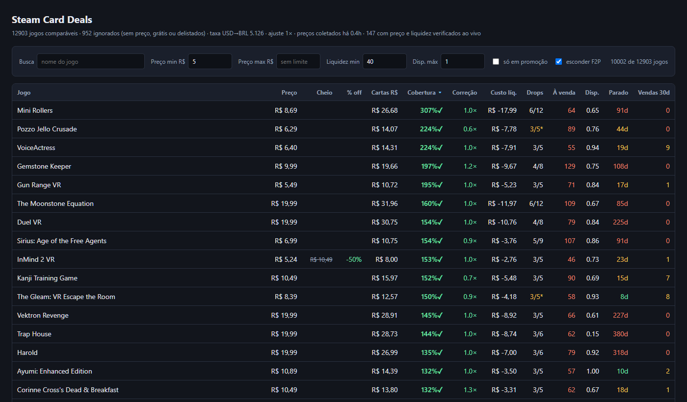

# Steam Card Deals

> Read in English: [README.md](README.md)



Cruza o valor das cartas colecionáveis de cada jogo Steam (coluna *Discount* do
[steam.tools/cards](https://steam.tools/cards/#)) com o preço atual da loja em BRL,
para achar jogos cujo custo líquido chega perto de zero.

## Resultado com dinheiro de verdade

Usei a ferramenta para comprar jogos e vendi as cartas que caíram (farm automático com o
[ArchiSteamFarm](https://github.com/JustArchiNET/ArchiSteamFarm), então tempo de jogo não custa nada):

- **Previsão contra o recebido:** em 2 levas e 57 cartas, o modelo previu R$ 43,00 e entraram R$ 40,74 na carteira, um erro de **−5% no total**.
- **Cada leva sozinha oscila ±30%** por sorteio: qual carta do set cai é aleatório (uma leva rendeu +35% com três cópias da carta cara; a outra, −24%).
- **O preço quase não andou** entre a compra e a venda (−2%).
- **Listar no preço de venda e esperar** rendeu 31% acima da mediana do mercado e ainda vendeu em cerca de meio dia.
- **O preço publicado pelo steam.tools fica velho:** chegou a aparecer 48× acima do real. Por isso a etapa 2 confere preço e giro ao vivo antes de qualquer compra.

## Leia isto antes de interpretar os números

- **Não é reembolso.** O retorno das cartas é *saldo da carteira Steam*, não dinheiro.
- **Não vem com a compra.** Cartas caem por tempo de jogo, e a Steam solta no máximo
  `ceil(nº_cartas / 2)` por conta — o resto você compra ou troca. Esse teto **já está
  embutido** no valor da coluna Cartas R$; ela nunca assume o set completo. A coluna
  **Drops** mostra o teto sobre o tamanho do set (`8/15`).
- **Liquidez importa mais que cobertura.** Um jogo com 24 cartas listadas no mercado
  inteiro mostra preço alto porque quase ninguém as tem; vender as suas derruba a
  cotação. Três colunas atacam isso, em ordem crescente de confiabilidade:
  **À venda** (estoque listado, grátis), **Disp.** (dispersão de preços dentro do set,
  grátis) e **Parado / Vendas 30d** (giro real, custa requisições — veja a etapa 2).
- **É um filtro de candidatos**, não recomendação de compra.

## Uso

```bash
python collect.py     # busca preços e alimenta cache/ (~70 requisições, ~2 min)
python report.py      # gera deals.csv e deals.html
```

Opcionalmente, a etapa 2 mede o fluxo real de vendas de uma lista curta:

```bash
python volume.py --top 60     # ~4 requisições por jogo; veja abaixo
python report.py              # colunas Parado / Vendas 30d aparecem
python cesta.py 13.47         # o que comprar com esse saldo
```

Abra `deals.html` no navegador: tabela ordenável por qualquer coluna, com busca e
filtros de preço mín/máx, liquidez mínima, só-em-promoção e esconder F2P.

O cache respeita TTL — preços valem 6 h, jogos grátis/delistados 7 dias. Rodar
`collect.py` de novo só busca o que venceu. Use `--force` para ignorar o TTL e
`--limit N` para testar com uma fatia pequena.

`report.py --ajuste 0.8` multiplica o valor das cartas por 0,8, se você quiser
margem de segurança contra queda de preço e iliquidez.

Outra região: `python collect.py --cc us` (limpe o `cache/prices.json` antes, e note
que a conversão do valor das cartas continua saindo em BRL).

## Arquivos

| Arquivo | Papel |
|---|---|
| `cardcalc.py` | Cálculo e parsing puros. Sem rede, sem disco. É o que os testes cobrem. |
| `marketpage.py` | Parsing puro das páginas HTML do Mercado (cartas, histórico, mediana). |
| `cachedb.py` | Leitura/escrita do cache e montagem da lista de deals. Compartilhado. |
| `volume.py` | Etapa 2: mede o giro real de uma lista curta, com throttle e resumível. |
| `cesta.py` | Dado o saldo da carteira, resolve que combinação de jogos comprar. |
| `biblioteca.py` | Baixa sua biblioteca Steam para podar jogos que você já tem. |
| `collect.py` | Só rede + cache. Lotes de 200 appids, grava a cada lote, resumível. |
| `render.py` | Monta o `deals.html` self-contained (sem CDN, abre offline). |
| `report.py` | Lê o cache, calcula, escreve `deals.csv` e `deals.html`. Nunca acessa a rede. |
| `cache/` | `set_data.json`, `currency.json`, `prices.json`. Fora do git. |

```bash
python -m unittest -v      # 107 testes, sem rede
```

Só biblioteca padrão do Python 3; não há dependências para instalar.

## Etapa 2: giro real do Mercado

**À venda** conta estoque parado; 188 cartas listadas podem ser 188 encalhadas. Só o
histórico de vendas separa mercado vivo de morto — e a diferença é brutal:

| | À venda | Disp. | Parado | Vendas 30d |
|---|---|---|---|---|
| ClockwiZZZe (112% cobertura) | 188 | 0,88 | **338 d** | **0** |
| Fireflies (81% cobertura) | 699 | 0,83 | **1 d** | **37** |

ClockwiZZZe passa em todos os filtros baratos e vende uma carta por mês.

### Como funciona

Os endpoints JSON do Mercado (`/priceoverview/`, `/search/render/`) respondem 429 de
forma persistente. As **páginas HTML** não — e trazem dado melhor: a página de um item
carrega o histórico completo de vendas (data e quantidade por dia), sem login. O
parsing está em `marketpage.py`.

Por jogo: uma requisição à busca para descobrir os nomes das cartas, depois uma por
carta amostrada. **3 cartas espalhadas pelo set, consolidadas pela mediana** — uma
carta sozinha mente: no ClockwiZZZe a carta *Dwarf* vendeu há 26 dias enquanto a
mediana do set é 338. Foils ficam de fora; negociam em outro mercado e não entram na
cobertura.

Nomes de carta nunca mudam, então vão para um cache permanente (`cache/cardnames.json`):
a página de busca (5 MB) é custo único por jogo, e rodadas seguintes só pagam as
páginas de item (~300 KB). O TTL do histórico é 7 dias.

### Por que não o booster pack

O nome do booster é construível sem busca (`<appid>-<Jogo> Booster Pack`), o que
custaria uma requisição por jogo em vez de quatro. Foi testado e **descartado**:

| | Booster 30d | Cartas 30d (cada) |
|---|---|---|
| ClockwiZZZe | 0 | ~0 |
| Defense Grid 2 | 1 | 45–58 |

Booster e carta são mercados independentes — gente compra carta para completar badge,
quase ninguém compra booster. Como proxy ele erra por ~50× e não separa vivo de morto.

### Operação

Medido: 12 jogos em ~2 min com `--delay 2.5`, sem nenhum 429. O cache grava a cada
jogo, então Ctrl+C não perde progresso e rodar de novo continua de onde parou. Se
aparecerem 429, o backoff dobra sozinho; aumente `--delay` ou reduza `--top`.

Jogos não medidos mostram `—` e vão para o fim ao ordenar por essas colunas.

## Como a conta é feita

```
cartas_brl = discount_usd * taxa_brl * ajuste
cobertura  = cartas_brl / preco_pago      # 1.0 = virtualmente de graça
custo_liq  = preco_pago - cartas_brl
```

O `discount_usd` vem do steam.tools e **já está líquido da taxa de 15% do Mercado**.
A fórmula foi confirmada contra a base inteira — bate em 341 de 341 sets acima de
US$ 5, ao centavo:

```
discount = ceil(nº_cartas / 2) × preço_médio_da_carta ÷ 1,15
```

O `ceil` reflete que meio set de número ímpar arredonda para cima (9 cartas → 5
drops), e o `1,15` é a taxa da Steam (5% plataforma + 10% desenvolvedor). Ou seja:
a coluna "Cartas R$" é o que cai na sua carteira, não o preço de vitrine, e uma
cobertura de 100% é 100% de verdade.

### Sets incompletos no Mercado

O `count` que a fórmula usa são as cartas que o steam.tools encontrou **precificadas
no Mercado**, não o tamanho real do set (`true_count`). Eles divergem em 4.587 dos
13.817 sets, e sempre na mesma direção: o Mercado vê menos cartas do que existem.

Quando isso derruba a conta de drops (`ceil(count/2) < ceil(true_count/2)`), o valor
das cartas fica **subestimado** — acontece em 2.618 jogos, marcados com `*` amarelo
na coluna Drops. O viés é sempre conservador: sua cobertura real é igual ou melhor
que a exibida, nunca pior.

A taxa USD→BRL vem do `currency.json` do próprio steam.tools.


## Escolhendo a compra

```bash
python cesta.py 13.47              # lucro máximo com esse saldo
python cesta.py 13.47 --dias-max 3 # só o que escoa rápido, para girar o caixa
```

Cada jogo só dropa cartas **uma vez por conta**, então isso é um problema de
mochila, não de ranking: não adianta repetir o melhor item, e o mais caro
raramente é o melhor uso do dinheiro. A conta roda em centavos inteiros — em
float, um jogo de R$ 1,79 não cabe num saldo de R$ 1,79.

### Podando o que você já tem

```bash
python biblioteca.py https://steamcommunity.com/id/SEU_PERFIL/
```

Grava `cache/owned.json`, e a partir daí `volume.py` e `cesta.py` ignoram esses
appids sozinhos — jogo que você já tem não rende drop novo, e cada medição custa
~4 requisições ao Mercado.

A página `/games/` do perfil **exige login mesmo com o perfil público**: "detalhes
do jogo" é uma configuração de privacidade separada. O endpoint que o steam.tools
usa (`stc-price.appspot.com/UserInfo`) consulta a Web API com chave própria e
devolve a lista sem isso.

Se a lista vier privada, o campo `games` volta `null` — tratado como "não sei",
nunca como "biblioteca vazia", que faria a ferramenta deixar de podar em silêncio.

### Promoções

Das 50 oportunidades verificadas numa rodada, 18 estavam em promoção e **todas as
18 deixam de compensar quando ela acabar** — nenhuma sobrevive a preço cheio. Mas
elas somam só R$ 11,90 de lucro; os 32 jogos a preço normal somam R$ 48,61. Ou
seja, 80% do prêmio está em preço estável e sem prazo.

A Steam não publica a data de término para jogos pequenos: `featuredcategories`
traz `discount_expiration` apenas para a dúzia de destaques curados, e a página
de um jogo obscuro não tem contagem regressiva. Então o risco existe mas não é
mensurável — e é pequeno o bastante para não guiar a ordem de compra.

## Licença

MIT. Projeto independente, sem ligação com a Valve ou com o steam.tools. Ele só lê páginas
públicas, com intervalo entre as requisições; use com moderação.
